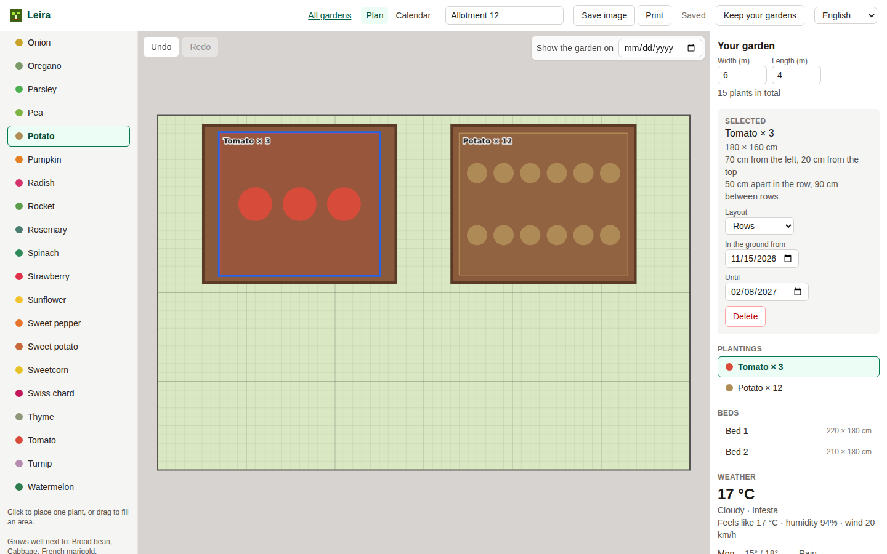

# Leira

[](https://github.com/pgraca97/leira/actions/workflows/ci.yml)

Plan a vegetable garden on a grid: draw beds, fill them with crops at the right spacing, and get
warned about crop rotation, bad neighbours and frost where the garden is.

A _leira_ is what a plot of cultivated land is called in Minho, in the north of Portugal.

> Work in progress. You start as a guest, with no sign-up, and can keep your gardens later with
> Google or a link sent by email.

**[Live demo](https://leira.paulodcgraca.workers.dev)**



## Features

- **Beds and plantings on a grid.** Drag to draw a bed or fill an area with a crop; the number of
  plants follows from the crop's spacing, as one plant, rows, a block or square-foot squares.
  Move and resize with handles, nudge with the arrow keys, duplicate with Ctrl+D, undo and redo.
  Pick several items with Shift (a click adds one, a drag draws an area, Ctrl+A takes all), or
  with "Select several" on a touch screen, then move, duplicate or delete them together.
  Copy and paste them into this garden or another; "Paste into next year" puts the crops in the
  same place a year later, which is how next season is planned. Save a selection as a named
  template and insert it into any of your gardens, its crops moved to the year shown.
  Zoom with the wheel, a pinch or the buttons.
- **45 crops** common in Portugal, with search, spacing, frost tolerance, days to harvest and the
  months each one goes in the ground. One tick narrows the list to what can be sown or planted
  out this month.
- **Advice:** crop rotation (same family in the same place too soon), companion planting, crops
  planned outside their season, and warnings from a 5-day forecast for the planted crops: frost,
  heat, nights too cold for seedlings that have just been planted out, and soil too cold for a
  seed due to be sown in place. The forecast gives each day's soil temperature 6 cm down. The
  garden is located by searching for its town or from the device's position.
- **Time:** show the garden on any date, a yearly calendar per planting or per bed, where each bed
  shows when it stands empty and which crops there is still room for, and the jobs of the last
  and the next 30 days. A job is ticked off with the day it was really done, and the calendar
  follows that day; a job that slipped stays on the list as overdue.
- **Records:** the variety of a planting, in the gardener's own words, a harvest log per planting,
  in kilos or units, with what the crop gave in total, and free notes on a planting and on the
  garden for what went wrong and what to try next year.
- **Export:** save the plan as a PNG or print a sheet with the plan and a planting table. The jobs
  still to do go to a phone or desktop calendar as an `.ics` file, and each year has a list of
  the plants to get, added up from the plan.
- **Share:** a read-only link shows a garden's plan and calendar to anyone, with no account. The
  owner chooses whether it says where the garden is, and can turn it off at any time. Notes and
  harvest amounts never leave with the link.
- **An example to look around.** A first visit can start from a ready-made garden whose crops
  follow the seasons, with a rotation mistake and good and bad neighbours to show the advice.
- **Accounts without a sign-up wall.** A guest gets a real user straight away. Signing in with
  Google or an emailed link attaches to that same user, so the gardens made as a guest are kept.
- **Portuguese and English** interface.

## Tech stack

| Layer    | Tools                                                                    |
| -------- | ------------------------------------------------------------------------ |
| Frontend | React 19, TanStack Router and Query, Tailwind CSS, Phaser for the canvas |
| State    | Zustand with zundo (undo history)                                        |
| Backend  | Cloudflare Worker with Hono, KV for the weather cache                    |
| Data     | Supabase (Postgres with row level security, anonymous and Google auth)   |
| Shared   | Zod schemas and the gardening logic in `packages/core`                   |
| Tooling  | pnpm workspaces, Turborepo, Biome, Vitest, Playwright                    |

## How to run

You need Node 24, pnpm, and Docker for the local Supabase stack.

```bash
pnpm install
pnpm db:start
cp apps/web/.dev.vars.example apps/web/.dev.vars
pnpm supabase status
pnpm dev
```

Copy the API URL and publishable key printed by `pnpm supabase status` into
`apps/web/.dev.vars`. The app runs at http://localhost:5173. Without an
[OpenWeather API key](https://home.openweathermap.org/api_keys) in the same file, everything works
except the weather panel.

## Tests

| Command                 | What it covers                                                                                                                                                          |
| ----------------------- | ----------------------------------------------------------------------------------------------------------------------------------------------------------------------- |
| `pnpm check`            | Lint, typecheck, unit tests and build. The database access rules run on an in-process Postgres, so no Docker.                                                           |
| `pnpm test:integration` | The gardens API, share links, the Worker's token check and the email sign-in flow against the local Supabase stack.                                                     |
| `pnpm test:e2e`         | Playwright: drawing, saving, the calendar, jobs done and harvests, export, sharing by link, signing in by emailed link, and that a visitor only sees their own gardens. |

The last two need `pnpm db:start` and a filled-in `.dev.vars`.

## Decisions

- **Gardening logic is pure.** Geometry, spacing, rotation, companions and schedules live in
  `packages/core` with no framework and no I/O, so they are tested without a browser.
- **One store, two views.** The editor state is a framework-free store. React and the Phaser
  scene both subscribe to it and never talk to each other.
- **Saves cannot overwrite newer work.** Each save carries the version the plan was loaded at,
  and the database refuses a stale one. The editor then offers to reload instead of losing an
  edit made in another tab.
- **The weather key stays on the server.** The Worker calls OpenWeather and caches each answer in
  KV per zone of about 11 km, so nearby gardens share one call. The garden itself only keeps its
  position rounded to about 1 km.
- **Soil temperature comes from a second provider.** OpenWeather's free plan has none, so the
  Worker asks [Open-Meteo](https://open-meteo.com/) (no key, free for non-commercial use) in the
  same call as the forecast and caches the two together. When Open-Meteo fails, the forecast still
  comes back, without the soil. Its data are under CC BY 4.0, credited next to them.
- **A shared link is a key, not an account.** The link carries a random token, and one database
  function is the only thing a visitor with no session can call: it hands over the name and the
  plan, and the location only if the owner allowed it. Opening a link therefore creates no guest
  user, and the gardens table stays closed to everyone but its owners. The owner's notes and
  harvest amounts are cut out by that same function, not by the Worker in front of it: whoever
  holds a token can call the function directly.
- **Next year lives in the same garden.** A plan spans as many years as its crops' dates do, and
  the rotation check compares those years. So planning next season is a paste a year on into the
  same garden, not a new garden. The clipboard sits in the browser's storage, so it also reaches
  another garden or tab.
- **What happened lives in the plan.** Jobs done, harvests and notes are fields of the plan
  document, not tables of their own, so they are saved, undone and checked for conflicts the same
  way as a moved bed. The document has a version, and older ones are brought up to date as they
  are read.
- **One visitor cannot spend the weather quota, and running out of cache writes breaks nothing.**
  The Worker counts calls per address, an IPv6 one by its /64 block since a machine can take any
  address in it: 60 a minute to the weather and place routes, and 10 a minute of those the cache
  cannot answer, since only these reach OpenWeather and write to KV. Cloudflare's limiter counts
  by the minute at most, so one address can still use up the free plan's 1000 daily KV writes in
  about 100 minutes. That only stops new answers being cached until midnight UTC: the routes keep
  answering from OpenWeather. Two gaps are left open while the app has a handful of users. A daily
  budget for everyone together would need a Durable Object. And the free plan's 100,000 daily
  Worker requests, which a refused request spends too, can only be guarded by Cloudflare rules in
  front of the Worker, which need a domain of its own.
- **Usage is counted for the owner, not for advertisers.** Two sources, both free. Cloudflare Web
  Analytics counts visits, pages and where people come from, with no cookies; its beacon loads only
  where the Worker has a token, which is production. The database keeps one row per person for
  each day they opened the app, so "came back" includes someone who only read their calendar. The
  page `/stats` shows those numbers and the free plan limits to the admins listed in
  `private.admins`, whose own use is left out. It is there to say when paying for a domain or a
  bigger plan would be worth it.
- **People can take their data and leave.** One database function hands over everything kept
  about the caller (account, profile, gardens with their links, activity days) as a JSON file with
  a format number, so a later import can read it. Another deletes the caller's user, and every
  table cascades from it. Both act only on whoever calls them, so there is nothing to check.

## Repository layout

| Path                | What it is                                                                 |
| ------------------- | -------------------------------------------------------------------------- |
| `apps/web`          | The React app (`src`) and the Worker that serves it and `/api` (`worker`). |
| `packages/core`     | The plan schema and the gardening logic.                                   |
| `packages/tsconfig` | Shared TypeScript settings.                                                |
| `supabase`          | Migrations, local stack settings and tests of the access rules.            |

## Deploying

The app is one Cloudflare Worker. It needs the three values from `.dev.vars.example` as secrets,
and a Supabase project with anonymous sign-ins, manual linking and the Google provider enabled,
an SMTP server for the emailed links, and the app's address as its site URL.

The first deploy is by hand, because a new Worker takes its secrets from a file:

```bash
pnpm supabase link --project-ref <project-ref>
pnpm supabase db push --remote
pnpm --filter @leira/web build
pnpm --filter @leira/web exec wrangler deploy --secrets-file <file>
```

The secrets file holds `NAME=value` lines and stays out of git. After the first deploy, change a
secret with `wrangler secret put`.

From then on a push to `main` deploys by itself: once every test has passed, CI applies the new
migrations and then publishes the Worker. It needs three secrets in the GitHub repository:

| Secret                  | What it is                                                               |
| ----------------------- | ------------------------------------------------------------------------ |
| `CLOUDFLARE_API_TOKEN`  | A Cloudflare API token made from the "Edit Cloudflare Workers" template. |
| `CLOUDFLARE_ACCOUNT_ID` | The id of the Cloudflare account the Worker is in.                       |
| `SUPABASE_ACCESS_TOKEN` | A Supabase access token that may write to the project's database.        |

Two steps are by hand, once:

- **Web Analytics.** In the Cloudflare dashboard, open Web Analytics, add a site with the Worker's
  hostname, and copy the token from its snippet. Then
  `pnpm --filter @leira/web exec wrangler secret put WEB_ANALYTICS_TOKEN`. Without it the app
  works the same, uncounted.
- **The stats page.** In the Supabase SQL editor, make your account an admin:
  `insert into private.admins (user_id) select id from auth.users where email = '<your email>';`
